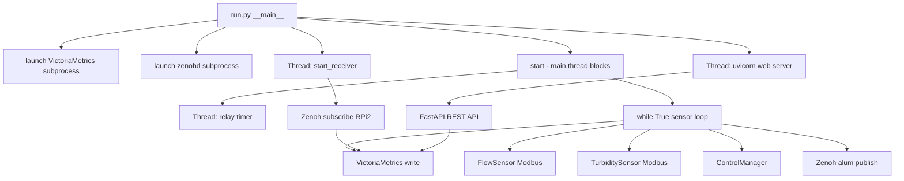
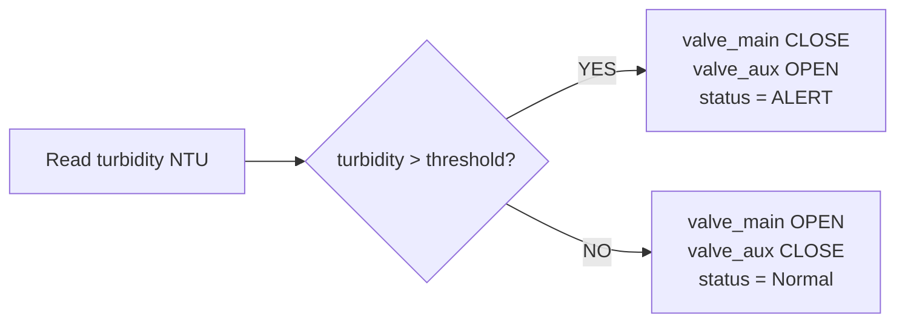
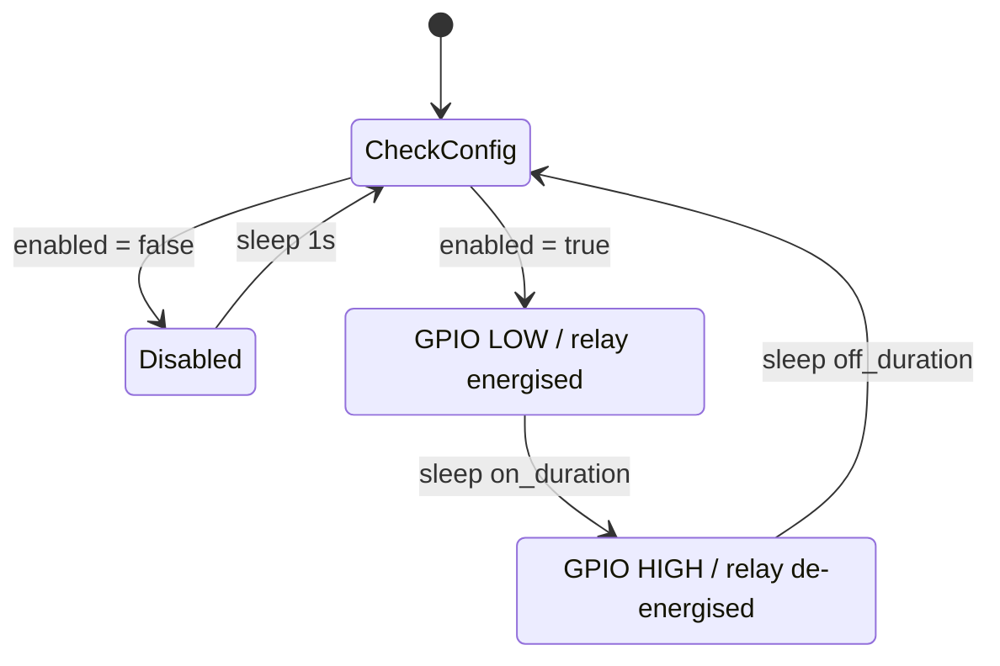

# Architecture

## High-Level Overview

RENO-RPI1 is a single-process Python application that integrates three concerns:

1. **Hardware control** — reads Modbus sensors and drives GPIO actuators on a 1-second cycle
2. **Data ingestion** — receives chemical-treatment sensor data from a second Pi (RPi2) over Zenoh
3. **Web dashboard** — exposes a FastAPI server for real-time monitoring and configuration

All three run concurrently inside the same OS process, coordinated with Python threads.

```
┌─────────────────────────────── RPi1 Process ───────────────────────────────┐
│                                                                              │
│  run.py (main thread)                                                        │
│  ┌────────────────────────────────────────────────────────────────────────┐  │
│  │  1. launch VictoriaMetrics subprocess          localhost:8428          │  │
│  │  2. launch zenohd subprocess                   localhost:7447          │  │
│  │  3. spawn Zenoh receiver thread                                        │  │
│  │  4. spawn Uvicorn thread                       0.0.0.0:8000            │  │
│  │  5. call start() — blocks on sensor loop                               │  │
│  └────────────────────────────────────────────────────────────────────────┘  │
│                                                                              │
│  Thread: Zenoh receiver        Thread: Relay timer      Thread: Uvicorn     │
│  (receiver.py)                 (main.py)                (water_ui/ui/main)  │
│     │ subscribe                    │ GPIO 16                │ FastAPI        │
│     │ reno/water/treatment/010     │ ON/OFF cycle           │ :8000          │
│     ▼                             ▼                        ▼                │
│  VictoriaMetrics write      Solenoid / Relay GPIO      HTML + REST API      │
│                                                                              │
│  Main loop (blocking)                                                        │
│     │ read Modbus /dev/ttyUSB1 → flow rate                                  │
│     │ read Modbus /dev/ttyUSB2 → turbidity NTU                              │
│     │ ControlManager.should_shutdown() → valve decision                     │
│     │ publish alum dose → Zenoh "reno/water/alum/pump"                      │
│     └ VictoriaMetricsLogger.log()                                           │
│                                                                              │
└──────────────────────────────────────────────────────────────────────────────┘
```

---

## Execution Flow (Ponytail Method)

Starting from `run.py`:

```
run.py
│
├── port_open(8428)? → if not: launch VictoriaMetrics subprocess
├── port_open(7447)? → if not: launch zenohd subprocess
│
├── threading.Thread → start_receiver()           [daemon thread]
│     └── zenoh.open() → subscribe reno/water/treatment/010
│           └── listener(sample) → json.loads → VictoriaMetricsLogger.log_treatment()
│
├── threading.Thread → run_ui()                   [daemon thread]
│     └── uvicorn.run("water_ui.ui.main:app", port=8000)
│           └── FastAPI app (lifespan: open Zenoh session)
│
├── _resolve_public_url()  → tailscale funnel / ngrok (optional)
│
└── start()                                       [main thread, blocks]
      │
      ├── GPIO.setmode(BCM)
      ├── ModbusSerialClient(/dev/ttyUSB1).connect()  → flow meter
      ├── ModbusSerialClient(/dev/ttyUSB2).connect()  → turbidity
      ├── GPIO.setup(RELAY_PIN=16, OUT) → HIGH (relay off)
      │
      ├── threading.Thread → _relay_timer_thread()  [daemon thread]
      │     └── loop:
      │           read relay_state.json
      │           if enabled: GPIO.LOW (on_dur) → GPIO.HIGH (off_dur)
      │           shared_state.set_relay_on(True/False)
      │
      ├── Solenoid(pin=18) → GPIO.setup(18, OUT), close() → GPIO.LOW
      ├── Solenoid(pin=17) → GPIO.setup(17, OUT), close() → GPIO.LOW
      ├── FlowSensor(client, slave_id=1)
      ├── TurbiditySensor(client, unit_id=4)
      ├── VictoriaMetricsLogger()
      ├── ControlManager()
      │
      └── while True (1 second):
            │
            ├── FlowSensor.get_flow_rate()
            │     └── read_holding_registers(addr=0, count=1, device_id=1) → float
            │
            ├── TurbiditySensor.read_voltage()
            │     └── read_holding_registers(addr=2, count=2, device_id=4)
            │           └── struct.unpack(">f", pack(">HH", r0, r1)) → NTU float
            │
            ├── ControlManager.should_shutdown(turbidity)
            │     └── turbidity > shared_state.get_threshold()
            │           → True: valve_main.close(), valve_aux.open()  [ALERT]
            │           → False: valve_main.open(), valve_aux.close() [Normal]
            │
            ├── alum_ml_per_min = flow × (dose_mg_per_l / 50.0)
            ├── _get_alum_publisher().put({"ml_per_min": ...})
            │     └── Zenoh publish → "reno/water/alum/pump"
            │
            └── VictoriaMetricsLogger.log(flow, v1, v2, turbidity, status)
                  └── POST /write  InfluxDB line protocol → localhost:8428
```

---

## Component Responsibilities

| Component | File | Responsibility |
|---|---|---|
| Orchestrator | `run.py` | Process lifecycle, subprocess management, thread spawning |
| Sensor loop | `full_system_package/main.py` | Main control loop, relay timer, alum dose publisher |
| ControlManager | `control/manager.py` | Turbidity alarm — valve state decision |
| VictoriaMetricsLogger | `database/victoria_logger.py` | InfluxDB line-protocol writes |
| FlowSensor | `hardware/flow_sensor.py` | Modbus flow-rate read |
| TurbiditySensor | `hardware/turbidity_meter.py` | Modbus turbidity read (IEEE 754 float) |
| Solenoid | `hardware/solenoid.py` | GPIO-driven solenoid valve |
| Zenoh receiver | `services/receiver.py` | Subscribe to RPi2 treatment data |
| Shared state | `shared_state.py` | Thread-safe relay status + threshold persistence |
| FastAPI app | `water_ui/ui/main.py` | REST API + Jinja2 dashboard |
| Dashboard HTML | `water_ui/ui/templates/index.html` | SPA — live/history/table views |

---

## Folder Organisation

```
RENO-RPI1/
├── run.py                  Entry point
├── shared_state.py         Cross-thread/cross-process state
├── requirements.txt
│
├── full_system_package/    All hardware + backend logic
│   ├── main.py             Sensor loop + relay + alum publishing
│   ├── control/            Decision logic
│   ├── database/           VictoriaMetrics client
│   ├── hardware/           GPIO and Modbus drivers
│   ├── services/           Zenoh subscriber
│   └── utils/              Configuration constants
│
└── water_ui/               Web interface
    └── ui/
        ├── main.py         FastAPI app
        └── templates/      Jinja2 HTML templates
```

---

## Data Flow

```
Physical sensors
  FlowMeter  ──Modbus RS-485──► /dev/ttyUSB1 ──► FlowSensor.get_flow_rate()  ─┐
  TurbiditySensor ──Modbus──── /dev/ttyUSB2 ──► TurbiditySensor.read_voltage() ─┤
                                                                                  │
                                                                  ▼               │
                                                      ControlManager              │
                                                  (turbidity > threshold?)        │
                                                      │         │                 │
                                                     YES        NO                │
                                                      │         │                 │
                                              valve_aux  valve_main               │
                                              OPEN       OPEN                     │
                                                                                  │
                                                                                  ▼
RPi2 treatment sensors                                           VictoriaMetrics
  (pH, ORP, RTD, EC, pumps)                                      localhost:8428
      │                                                               ▲
      │ Zenoh reno/water/treatment/010                                │
      ▼                                                               │
  start_receiver() thread ──────────────────────────────────────────►│
                                                                      │
  start() loop ──────────────────────────────────────────────────────►│
                                                                      │
  FastAPI /api/live, /api/range, /api/table ◄──── PromQL queries ────►│
      │
      ▼
  Web browser (Dashboard)


Alum dosing feedback:
  FlowSensor → alum_ml_per_min = flow × (dose / 50) → Zenoh "reno/water/alum/pump" → RPi2
```

---

## Configuration Files (Runtime State)

Three JSON files in the project root persist settings across restarts. The web UI writes them; the sensor loop reads them every iteration.

| File | Schema | Default |
|---|---|---|
| `threshold_state.json` | `{"turbidity_threshold": <float>}` | 10.0 NTU |
| `dose_state.json` | `{"dose_mg_per_l": <float>}` | 10.0 mg/L |
| `relay_state.json` | `{"enabled": bool, "on_duration_seconds": float, "off_duration_seconds": float}` | disabled |

---

## Design Patterns

- **Thread-per-concern** — each long-running concern (sensor loop, relay timer, Zenoh receiver, web server) runs in its own daemon thread.
- **File-based shared config** — JSON files serve as the IPC channel between the web process (write) and the hardware loop (read), avoiding the need for a configuration database.
- **Retry on transient failures** — `VictoriaMetricsLogger._send()` retries 3× on HTTP errors. Modbus failures return safe defaults (0.0 / None) rather than crashing.
- **Last-known-good turbidity** — the sensor loop caches the last successful turbidity reading and uses it for control decisions if a read fails, preventing false alarms from noise.
- **Active-LOW relay** — GPIO LOW energises the relay module; the code accounts for this with inverted logic in `_relay_timer_thread`.

---

## Mermaid Diagrams

### Thread Architecture



### Control Decision



### Relay Timer


